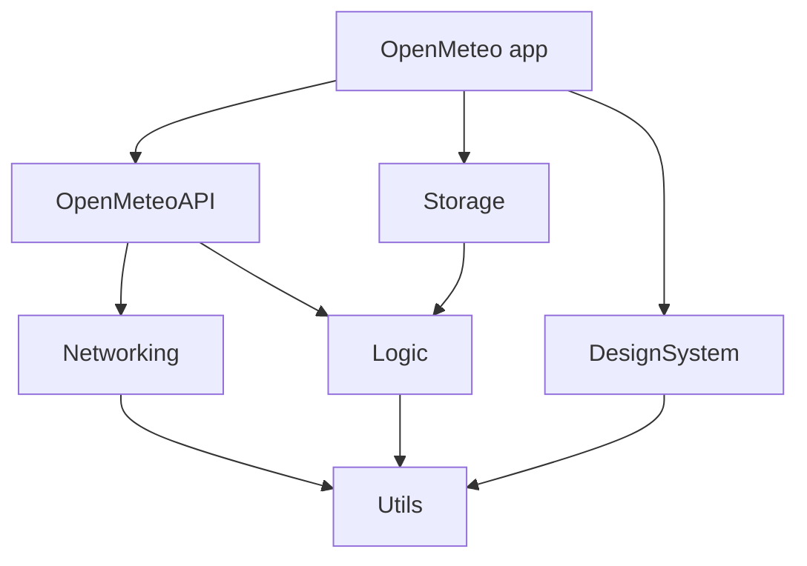

# Where to?

An iPhone app that ranks skiing, surfing, outdoor sightseeing and indoor sightseeing for the next 7 days in a searched city. It uses the Open-Meteo Geocoding and Forecast APIs. Built with SwiftUI and Swift 6, for iOS 27.

## Modules

There are six local Swift packages. Logic is the domain core and depends only on Utils. The I/O packages implement Logic's ports, so every dependency points inward.

The app also imports Logic, Networking and Utils directly. The graph leaves out those transitive edges.

| Package      | Responsibility                                                                             | Key types                                                                                 |
| ------------ | ------------------------------------------------------------------------------------------ | ----------------------------------------------------------------------------------------- |
| Utils        | Helpers with no domain knowledge: numerics, collections, text, time and coding             | `TaskSleeper`, `SystemDateProvider`, `DataDecoding`                                       |
| Networking   | A generic HTTP client with retry and observation                                           | `NetworkClient`, `RequestBuilder`, `ExponentialBackoffRetryPolicy`, `URLSessionTransport` |
| Logic        | Models, scoring, ranking, the search flow, and forecasts with cache fallback and freshness | `ForecastService`, `WeightedActivityScorer`, `ActivityRanker`, `CitySearchFlow`           |
| OpenMeteoAPI | The Open-Meteo adapter: request factories, DTOs, and mappers to Logic models               | `OpenMeteoGeocoder`, `OpenMeteoWeatherForecaster`                                         |
| Storage      | File persistence for the forecast cache and the recent cities                              | `CodableWeatherCache`, `CodableRecentCitiesStore`, `FileDataStore`                        |
| DesignSystem | SwiftUI components and the rating scale                                                    | `ScoreRing`, `DailyBars`, `TopPickCard`, `Rating`                                         |

- **Ports:** Logic declares four ports in `Ports/`. OpenMeteoAPI implements `CityGeocoding` and `WeatherForecasting`; Storage implements `WeatherCaching` and `RecentCitiesStoring`.
- **Mocks:** `UtilsMocks`, `LogicMocks` and `NetworkingMocks` sit in the lowest package that can see each protocol. The test targets of the packages above share them.
- **App test doubles:** the hosted `OpenMeteoTests` target cannot link the mock products, because it would get a second static copy of Logic. Its doubles live in `OpenMeteoTests/Support/Doubles` instead.

## Development process

The app was built with Claude Code, run as an agentic loop. The engineer decides scope and approves plans, and is the only one who merges.

**Setup**

1. **Rules in context:** `CLAUDE.md` and memory files hold the house rules, and every agent starts with them:
   - no comments beyond the Xcode header;
   - no top-level declarations;
   - every service injected as a protocol;
   - a protocol with a single conformer lives in that conformer's file;
   - force unwraps only for constants that tests pin.
2. **Skills:** SwiftUI, Swift concurrency, Swift Testing, networking and accessibility guides load on demand.
3. **Hooks:**
   - `UserPromptSubmit`: a Haiku classifier flags complex prompts, such as research, hard debugging or multi-file changes, so they run as multi-agent workflows.
   - `Stop`: a review gate keeps the turn from ending until the uncommitted diff has been through `/code-review`.
4. **Scripts:** the pipeline scripts in `scripts/` are the same locally and in CI, so an agent verifies exactly what CI runs.

**Loop for one task**

1. **Plan:** read the brief and the UI spec, explore the code, and write a plan for approval.
2. **Fan out:** a workflow script splits the work into a dependency graph.
   - **By layer:** Utils, then Logic, Networking and DesignSystem, then Storage and OpenMeteoAPI, then the app. Agents in the same layer run in parallel.
   - **By module:** one agent owns each module end to end, covering sources, mocks and tests. Agents never touch each other's files, and each one compile-checks its own package.
3. **Integrate:** run the full pipeline on a fresh simulator. Failures go back to the agent that owns the module.
4. **Review:** `/code-review` raises findings, and verifier agents try to refute each one. Every confirmed finding is fixed or triaged.
5. **Measure:** check line coverage per package, and prune or add tests to stay in the 70–80% band.
6. **Deliver:** split the change into stacked PRs of reviewable size. Each one is verified with the full pipeline in its own worktree, and it opens only after the previous one is merged.

## CI

`.github/workflows/build-and-test.yml` runs on pushes to `main`, on pull requests and on demand. It uses a self-hosted macOS ARM64 runner, because GitHub-hosted images do not ship Xcode 27. The YAML only calls scripts:

1. `scripts/simulator.sh create` creates a fresh iPhone 17 Pro simulator for the run.
2. `scripts/build-for-testing.sh` does one build, with coverage enabled.
3. `scripts/test.sh unit|snapshot|ui` runs `test-without-building` serially into result bundles. A suite is retried once if the test runner fails to launch.
4. `scripts/coverage-summary.py` writes the app's line coverage table to the job summary.
5. The result bundles are uploaded and kept for 14 days, and the simulator is deleted.

A new push cancels the PR run it supersedes. To run the pipeline locally, export `SIMULATOR_UDID` and run the same scripts; the output goes to `build/`.

## Tests

The unit and snapshot tests use Swift Testing; the UI tests use XCTest.

**Unit tests**

| Target            | Tests | Line coverage |
| ----------------- | ----: | ------------: |
| UtilsTests        |    55 |         78.8% |
| NetworkingTests   |    41 |         79.1% |
| LogicTests        |   186 |         78.6% |
| StorageTests      |    29 |         75.7% |
| OpenMeteoAPITests |    84 |         77.8% |
| OpenMeteoTests    |   126 |         79.2% |

The figures exclude SwiftUI view bodies, previews and mocks, which the snapshot and UI tests cover. Tests target behaviour and branches. Tests of mocks, Foundation pass-throughs and duplicate parameter rows were removed. The CI summary covers only the app target; the package figures come from running each package scheme with `-enableCodeCoverage YES`.

**Snapshot tests**

`DesignSystemTests` uses swift-snapshot-testing. Each of the 13 components is recorded three times: light, dark and an accessibility text size. That makes 39 reference images, all in the `en_GB` locale with 98% perceptual precision. `RatingTests` pins the rating thresholds, the clamping of scores outside 0–100, and the legend text.

**UI tests**

`OpenMeteoUITests` uses page objects (`SearchPage`, `RankingPage`, `ActivityDetailPage`, `HowScoresPage`) with wait helpers. The tests launch the app with `--sample-data`. In DEBUG builds that argument swaps in `SampleAppComposer`, which builds the preview session, so the runs never touch the network and the data never changes.

There are three tests:

- the first-launch state;
- a single-character query that keeps the first-launch state;
- the full flow: search, ranking, How scores, activity detail, back to search, and the city shown in recents.
